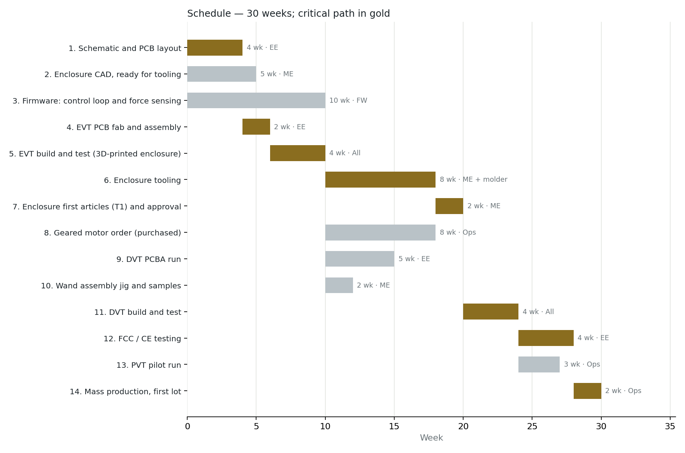

# System Description: Bubbler

| Field | Value |
|-------|-------|
| Version | 0.1 |
| Date | 2026-02-25 |
| Author | Electrum workflow |
| Status | Draft |
| Related docs | explore_notes.md, high_level_design.md, component_arrangement.md |

---

## 1. Product Vision and Context

**Product statement:**
For families, performers, and outdoor event organizers, Bubbler is a battery-powered automated soap bubble machine that produces large bubbles (up to ~500mm diameter) at a steady pace, using force-sensing feedback to auto-optimize bubble size and stability in light wind. Unlike cheap rotating-disk bubble machines that produce only small bubbles unreliably, Bubbler produces large, stable bubbles consistently — even in crosswinds up to 4 kph.

**Problem:**
Large soap bubbles captivate audiences but are difficult to produce reliably by hand — they require precise airflow speed, soap film thickness, and timing. Existing consumer bubble machines use spinning disks with fixed fan speed, producing small (20–50mm) bubbles with high pop rates and no adaptation. A machine that can produce large bubbles at a good pace and adapt to conditions (wind, solution age, temperature) fills the gap between cheap toys and professional stage equipment.

**Deployment context:**
- Environment: Outdoor — parks, backyards, event venues, street performance
- Setting: Portable, placed on a table or the ground
- User type: Consumer — families, entertainers, event planners
- Installation: None — fill vat with solution, insert batteries, press power
- Expected lifespan: 2–3 years (outdoor toy with wet/dry cycles, mechanical wear on pivot)

---

## 2. User Scenarios

### Scenario 1: Backyard Party
**Persona:** Sarah, parent hosting a children's birthday party outdoors.
**Situation:** Sets up Bubbler on a patio table 30 minutes before guests arrive. Light breeze (~3 kph).
**Action:** Fills the vat with soap solution (premixed concentrate + water). Presses power. Selects continuous mode. Bubbler begins cycling: dip → rotate up → inflate → release. First few cycles, the firmware calibrates — one or two pops, then it adapts fan ramp and dip duration. Within 5–6 cycles, large bubbles (~400mm) are releasing steadily every 8–12 seconds.
**Outcome:** A steady stream of large bubbles drifting across the yard. The machine runs unattended for 2+ hours until the solution runs low. LEDs blink amber when solution is low.

### Scenario 2: Street Performer
**Persona:** Diego, a street performer who uses giant bubbles as part of his act.
**Situation:** Sets up Bubbler on a small folding table in a pedestrian plaza. Wind is variable, 2–5 kph with gusts.
**Action:** Uses single-bubble mode — each cycle produces one bubble, waits for a button press to start the next. Between cycles, Diego adjusts his position relative to the wind. The firmware detects windier conditions via asymmetric force curves and automatically increases fan speed slightly and shortens blow duration.
**Outcome:** Large bubbles (~300–500mm depending on wind) released on cue. Diego controls timing; the machine handles the physics.

### Scenario 3: First Use — Unboxing
**Persona:** A buyer who just received the product.
**Situation:** Opens box, reads quick-start card.
**Action:** Inserts 4×AA batteries. Mixes soap solution using included concentrate + water, pours into vat. Presses power button. Green LED lights (powered). Presses mode button to select continuous mode. The wand arm dips into the vat, soaks for ~2 seconds, rotates up. Fan ramps gently. First bubble may pop (firmware starts with conservative default parameters). By cycle 3–5, bubbles are forming and releasing.
**Outcome:** Working bubbles within 2 minutes of setup. No app needed, no pairing, no configuration.

### Scenario 4: Error — Solution Runs Out
**Persona:** Sarah, mid-party.
**Situation:** Solution level drops below the loop's reach. The wand dips but picks up no film.
**Action:** Firmware detects no-film condition via the force curve — no force buildup during blow phase (flat signal). After 3 consecutive no-film cycles, Bubbler pauses and blinks amber LED. If capacitive solution sensor is included, it triggers immediately on low level.
**Outcome:** Machine stops cycling to avoid running the fan with no film (wasting battery). User sees amber LED, refills vat, presses button to resume.

### Scenario 5: Error — Wind Too Strong
**Persona:** Diego, wind picks up to 8+ kph.
**Situation:** Bubbles pop during inflation on every cycle. Force curve shows rapid rise then immediate drop (pop signature).
**Action:** Firmware detects 5+ consecutive pops. Increases fan speed to maximum compensation. If still popping, enters "wind pause" — stops cycling, blinks red LED twice every 5 seconds. Resumes automatically when user presses button (to try again after repositioning) or after a 2-minute timeout.
**Outcome:** Machine doesn't waste solution cycling in unworkable wind. User repositions or waits for a lull.

---

## 3. System Architecture

**Architecture narrative:**

Bubbler is a standalone, battery-powered electromechanical device with no wireless connectivity. The system consists of a mechanical subsystem (wand arm with flexible loop, rotating shaft, open vat, centrifugal blower with L-bent air duct) driven by a firmware control loop running on an ARM Cortex-M0 MCU.

The core signal chain: strain gauge on the wand arm pivot → HX711 24-bit ADC → MCU firmware. The firmware samples the force curve at 10–50 Hz during each blow cycle, analyzes the shape (slope = inflation rate, peak = bubble size proxy, sudden drop = pop, smooth peak → gradual decline = clean detach), classifies the outcome, and adjusts parameters for the next cycle. The controlled parameters are: fan PWM ramp profile, peak fan speed, dip duration (how long the loop soaks), and pause-before-blow (settling time after rotation).

Power comes from 4×AA batteries (6V nominal) through a 3.3V regulator for the MCU and HX711, with the motors driven from the battery rail via MOSFET (fan) and H-bridge (pivot motor). The user interface is minimal: a power button, a mode button (continuous / single / demo), and 3–5 status LEDs.

There is no app, no cloud, no wireless. All intelligence is on-device. The firmware's optimization loop runs autonomously — the user fills the vat, presses power, and walks away.

---

## 4. Subsystem Descriptions

*One subsection per subsystem lead in `team.md`: 4.1 Electrical, 4.2 Firmware, 4.5 Mechanical / industrial design. 4.3 and 4.4 are kept to record that V1 has no app and no cloud. Each subsection ends with its Handoff block.*

### 4.1 Hardware Subsystem

**MCU / SoC:**
- Part: STM32C011F4 (or STM32C011F6 if more flash needed)
- Selection rationale: Cheapest ARM Cortex-M0+ with sufficient peripherals. No wireless needed (standalone product), so BLE-capable MCUs (nRF52, ESP32) are wasted cost. The STM32C011 provides: 2× hardware timers for PWM (fan + motor), SPI or bit-banged interface for HX711, ADC channel for battery voltage, and GPIOs for buttons/LEDs. At $0.70–0.90 in volume, it's the right price for a sub-$50 product.
- Key specs: 48 MHz Cortex-M0+, 16–32 KB flash, 6 KB RAM, 12-bit ADC, 2× 16-bit timers with PWM, SPI, UART, up to 15 GPIO

**Sensors:**

| Sensor | Measures | Interface | Sample Rate | Key Spec |
|--------|----------|-----------|-------------|----------|
| Foil strain gauge (120Ω, bonded near shaft pivot) | Force on wand arm during bubble inflation | HX711 ADC (24-bit, differential) | 10–80 Hz (HX711 selectable) | Sensitivity: ~2 mV/V at full range. Resolves ~5 mN force changes. Measures 50–200 mN total range during inflation. |
| Battery voltage divider (2× resistors) | Battery voltage for fuel gauge | MCU ADC channel | 1 Hz | Detects low battery (<4.2V for 4×AA), triggers amber LED and reduced-power mode |
| Capacitive solution level (optional) | Soap solution present/absent in vat | MCU GPIO (capacitive touch peripheral or RC time constant) | 1 Hz | Binary threshold: solution present above loop level, or low. Simple and cheap (~$0.10 for electrode + firmware). |

**Actuators:**

| Actuator | Function | Interface | Key Spec |
|----------|----------|-----------|----------|
| Centrifugal blower fan (~40×40×10mm) | Generate directed airflow through L-bent duct to inflate soap film | MCU PWM → N-channel MOSFET | Variable speed 0–100% via PWM. Target air velocity at duct exit: 0.5–2 m/s. Pressure optimized (centrifugal) for duct losses. 5V or 6V rated. |
| Geared DC motor (~15×10×8mm, ~100:1 ratio) | Rotate shaft ~175° (dip position ↔ blow position) | MCU PWM + DIR → H-bridge (DRV8837 or similar) | Slow, smooth rotation (~1–2 seconds per 100° sweep). Low torque required (loop + arm < 50g). High gear ratio for smoothness and holding torque. |

**Physical UI elements:**
- Buttons: 2× tactile pushbuttons — power on/off, mode select (cycle through: continuous / single / demo)
- LEDs: 3–5× 3mm LEDs — green (power on), blue (running/cycling), amber (low solution or low battery), red (error / wind pause). Possibly one RGB LED instead.
- Display: None
- Other: None

**PCB strategy:**
- Single board, 2-layer FR4, ~50 × 35mm
- Components: STM32C011 (TSSOP20 or QFN), HX711 (SOP16), DRV8837 H-bridge (WSON8), N-ch MOSFET for fan, 3.3V LDO (MCP1700 or AP2112K), battery voltage divider, LED drivers (resistors), button pull-ups, strain gauge connector, motor connector, fan connector, battery connector
- All through-hole connectors (JST-PH) for wire harness to motors, fan, strain gauge, battery, LEDs, buttons
- SWD debug/programming pads (Tag-Connect TC2030 footprint for production, 0.1" header for dev)
- Board mounts inside the sealed electronics compartment in the tall side of the U-rim

**Handoff**
- Lead: Electrical / electronics lead
- Deliverables at gate: schematic and layout released; strain-gauge signal chain measured on the bench (noise floor against the 5 mN resolution target, with the motor running); EVT power budget measured against §6; FCC Part 15B / CE EMC pre-scan plan
- Needs from other domains: PCB outline, mounting bosses and connector exits from Mechanical (§4.5); pin map and PWM frequencies agreed with Firmware (§4.2); gauge bonding location from Mechanical (open question #1)

### 4.2 Firmware Subsystem

**Architecture:**
- OS/framework: Bare-metal (superloop with timer interrupts)
- Rationale: The system has only two time-critical tasks: HX711 sampling (10–80 Hz, interrupt-driven) and PWM generation (hardware timer). Everything else (state machine, optimization, LED management) runs in the main loop at ~100 Hz. No RTOS overhead is justified for a $0.80 MCU with 6 KB RAM.

**Major modules:**

| Module | Responsibility | Inputs | Outputs |
|--------|---------------|--------|---------|
| HX711 driver | Bit-bang SPI to read 24-bit force samples from HX711 at configured rate (10 or 80 Hz). Applies tare offset. | HX711 DOUT + SCK pins | Raw force value (grams-force, tared) |
| Force curve analyzer | Buffers force samples during each blow cycle. Extracts features: peak force, slope during inflation, time to peak, drop rate after peak. Classifies outcome: success (clean detach), pop (abrupt mid-rise drop), no-film (flat), partial (low peak). | Buffered force samples | Cycle outcome classification + extracted features |
| Optimization controller | Adjusts parameters for next cycle based on outcome history. Maintains a parameter set: {fan_ramp_rate, fan_peak_speed, dip_duration_ms, soak_pause_ms, blow_duration_ms}. Uses simple hill-climbing: on success, make small random perturbation; on failure, revert last change and try a different direction. Tracks rolling success rate over last 10 cycles. | Cycle outcome + features | Updated parameter set for next cycle |
| Cycle state machine | Sequences the dip-rotate-blow cycle: IDLE → DIP_DOWN → SOAK → ROTATE_UP → SETTLE → BLOW → RELEASE → ROTATE_DOWN → repeat. Manages timing for each phase using current parameter set. | Mode (continuous/single), optimization parameters, button events | Motor commands, fan commands, phase timing |
| Motor controller | Drives pivot motor via H-bridge with soft-start/stop velocity profiles. Uses timed open-loop control (no encoder): run motor at calibrated PWM for calibrated duration to achieve ~175° rotation. End-stop detection via stall current or limit switches (TBD). | Direction + speed commands from state machine | H-bridge PWM + DIR signals |
| Fan controller | Drives blower fan via MOSFET PWM. Implements configurable ramp profile: linear or exponential spin-up from 0 to target speed over configurable duration. Gentle ramp is critical — sudden air blast pops the film. | Fan speed target + ramp parameters from state machine | Fan MOSFET PWM signal |
| Battery monitor | Samples battery voltage at 1 Hz via ADC. Applies low-pass filter. Detects low battery (< 4.2V for 4×AA) and critical battery (< 3.8V). On low: amber LED. On critical: stop cycling, red LED. | ADC reading | Battery state (OK / low / critical) |
| LED manager | Drives LED GPIOs based on system state. Supports solid, blink, and pulse patterns. Priority: red (error) > amber (warning) > blue (running) > green (power). | System state flags | GPIO outputs |
| Solution monitor (optional) | Reads capacitive level sensor. Detects solution absent. After 3 consecutive no-film + no-solution readings, pauses and alerts. | Capacitive sense GPIO | Solution state (OK / low) |

**OTA update strategy:**
- None for V1. Firmware programmed at factory via SWD. Field updates require physical access (Tag-Connect or pogo-pin jig). Acceptable for a consumer toy at this price point.

**On-device processing:**
- Force curve feature extraction: peak detection, slope calculation, drop-rate measurement — all integer math on 24-bit samples
- Optimization: hill-climbing on 5 parameters with rolling success-rate tracking. No floating point required. State persisted in flash (last-known-good parameter set survives power cycles).
- All processing is local. No connectivity, no external dependencies.

**Boot-to-ready:** ~500ms (power-on → clock init → peripheral init → tare strain gauge → enter IDLE state → green LED on)

**Handoff**
- Lead: Firmware lead
- Deliverables at gate: skeletons for the nine modules above; force-curve classifier validated on recorded prototype curves (success / pop / no-film / partial); hill-climbing convergence shown within 10 cycles on the bench; firmware version struct in flash readable over SWD (gate gap #34)
- Needs from other domains: calibrated PWM-to-angle figures and end-stop behaviour from Mechanical; HX711 wiring, pin map and battery thresholds from Electrical; production test sequence agreed with Manufacturing / NPI

### 4.3 Mobile / Companion App Subsystem

**Not applicable.** Bubbler V1 is fully standalone. No app, no connectivity.

Future V2 option: BLE companion app showing real-time force curves (satisfying to watch), cycle statistics, and target bubble size adjustment. Would require adding an nRF52810 (~$1.50) or ESP32-C3 (~$1.20) as a BLE co-processor, connected to the STM32 via UART. The PCBA has space reserved for this.

**Handoff**
- Lead: none in V1 (no App lead on the team)
- Deliverables at gate: none
- Needs from other domains: Electrical keeps the UART header and board space reserved for a V2 BLE co-processor

### 4.4 Cloud / Backend Subsystem

**Not applicable.** No cloud, no accounts, no data collection.

**Handoff**
- Lead: none in V1 (no Cloud / backend lead on the team)
- Deliverables at gate: none
- Needs from other domains: none

### 4.5 Mechanical and Structural Subsystem

**Actuators and drives:**
- Pivot: geared DC motor ~15×10×8mm, ~100:1 ratio, driving a stainless shaft spanning ~180mm on two bearings; ~175° sweep between the dip end-stop (loop horizontal, submerged) and the blow end-stop (loop vertical, facing the duct); 1–2 s per 100° with soft-start/stop; load < 50 g (arm + loop + film), so torque is not the constraint, smoothness is
- Airflow: centrifugal blower ~40×40×10mm, PWM 0–100%, through an L-bent duct with a Ø40mm exit aimed at the vertical loop; target 0.5–2 m/s at the loop, pressure-optimised for duct losses
- Wand: 30mm arm with a 160mm loop (spring-wire or coated wire, open question #4); the arm is the flexure element for the strain gauge

**Structure:**
- Three injection-moulded parts, ABS or PP: base (battery compartment, feet, motor mount), tapered U-rim (sealed electronics compartment on the tall side, duct and blower in the protrusion, shaft bearings), removable vat (200 × 170mm oval, 20mm deep, ~500mL, snap-on lid for transport)
- Load paths are small (< 1 N dynamic); the design constraint is arm stiffness so flex does not corrupt the gauge signal, and a pivot with no backlash or stick-slip
- Footprint 215 × 206mm, height ~250mm to the loop top, 350–450 g without cells; four rubber levelling feet
- Simple draft-angle moulds, no undercuts; tooling 8 weeks, the longest item on the schedule

**Physical interfaces:**
- Wet/dry boundary at the shaft: labyrinth seal where the shaft enters the U-rim; strain gauge on the dry side near the bearing, conformal-coated
- IPX4 electronics compartment; vat and wand fully wettable
- Battery compartment sealed from the vat side; tool-release latch if the product is classified as a toy (open question #6)
- Harness exits for motor, blower, end-stop switches and gauge, all JST-PH into the sealed compartment

**Control loops:**
- Position: timed open-loop PWM with two end-stop micro-switches (decision #6); calibrated at the factory
- Film: force curve from the gauge at 10–80 Hz drives the cycle timing (dip, soak, rotate, blow) through the firmware optimiser (§4.2); mechanical requirement is a vibration path from motor to gauge below the 5 Hz firmware cutoff's noise budget
- Safety: motor stall detection by current or end-stop timeout; fan ramp never steps, always ramps

**Handoff**
- Lead: Mechanical / industrial design lead
- Deliverables at gate: enclosure CAD for the three parts ready for tooling quotes; wand, shaft, bearing and seal drawings; duct airflow measured at the loop (0.5–2 m/s across the 160mm opening); gauge mounting location and bonding method decided (open question #1); loop material decided (open question #4)
- Needs from other domains: PCBA outline and connector positions from Electrical; motor velocity profile limits from Firmware; mould and bonding-step quotes from Manufacturing / NPI

---

## 5. Interfaces

### Internal Interfaces (within device)

| Interface | From | To | Protocol | Data | Rate | Notes |
|-----------|------|----|----------|------|------|-------|
| Force sensing | Strain gauge (Wheatstone bridge) | HX711 ADC | Analog differential (µV–mV) | Force proportional to wand arm load | Continuous (analog) | 120Ω gauge, 3.3V excitation, ~2 mV/V sensitivity |
| Force data | HX711 DOUT pin | MCU GPIO (bit-banged SPI) | Serial clock + data (proprietary HX711 protocol) | 24-bit signed force reading | 10 Hz or 80 Hz (selectable via HX711 RATE pin) | MCU generates SCK, reads DOUT. Data ready signaled by DOUT going low. |
| Fan speed | MCU PWM timer | N-ch MOSFET gate | 25 kHz PWM, 0–100% duty | Fan speed command | Updated per cycle phase (ramp profile) | MOSFET: IRLML6344 or similar logic-level N-ch. Fan on battery rail (6V). |
| Motor direction + speed | MCU GPIO × 2 | DRV8837 H-bridge (IN1, IN2) | Logic-level GPIO: IN1=H/IN2=L → forward, IN1=L/IN2=H → reverse, both L → brake/coast | Motor direction + speed | State changes during cycle (dip down / rotate up) | DRV8837: 1.8A peak, built-in shoot-through protection. Motor on battery rail. |
| Battery voltage | Resistor divider (100kΩ + 100kΩ) | MCU ADC | Analog, 0–3.3V (half of battery voltage) | Battery state | 1 Hz | Divide by 2: 6V battery → 3V at ADC. 12-bit resolution = ~1.5 mV/step. |
| Buttons | 2× tactile switches | MCU GPIO (internal pull-up) | Active-low digital | Button press/release | Event-driven (interrupt + debounce) | 20ms debounce in firmware |
| LEDs | MCU GPIO × 3–5 | LEDs via current-limiting resistors | Logic-level GPIO, sink or source | LED state | State-driven | 10–20mA per LED, 150Ω–330Ω resistors |
| Solution level (optional) | Capacitive electrode on vat wall | MCU GPIO | RC time constant measurement | Solution present / absent | 1 Hz | Electrode is a copper trace on a flex PCB adhered to vat exterior. Firmware measures charge time. |

### External Interfaces (device to outside world)

| Interface | From | To | Protocol | Data | Rate | Notes |
|-----------|------|----|----------|------|------|-------|
| Battery | 4×AA cells in holder | Device power rail | Direct DC, 4.5–6.5V (1.0–1.6V per cell × 4) | Power | — | User-replaceable. Alkaline or NiMH. |

### Physical Connectors

| Connector | Purpose | Type | Notes |
|-----------|---------|------|-------|
| Battery holder (4×AA) | Power | 2×2 AA holder with snap-fit leads + JST-PH 2-pin to PCBA | User-accessible compartment with thumb-screw or snap lid |
| Strain gauge | Force signal to HX711 | JST-SH 4-pin (E+, E-, S+, S-) | Shielded cable, ~100mm, routed through U-rim from gauge near shaft to PCBA |
| Motor | Pivot drive | JST-PH 2-pin | ~80mm wire, internal routing |
| Fan | Blower drive | JST-PH 2-pin | ~60mm wire, internal routing |
| SWD debug/programming | Factory firmware load + debug | Tag-Connect TC2030-CTX (6-pin, no-legs) | Pogo-pin jig, not user-accessible. Pads on PCBA. |
| Vat contact (optional) | Capacitive level sense | Flex PCB electrode adhered to vat exterior | No connector — direct solder or ZIF to main PCBA |

---

## 6. Power Architecture

**Power source:** 4×AA batteries in a 2×2 flat holder. 6V nominal (alkaline), 4.8V nominal (NiMH). No charging circuit — user-replaceable cells.

**Power rails:**

| Rail | Voltage | Source | Load |
|------|---------|--------|------|
| V_BAT | 4.5–6.5V (varies with chemistry and discharge) | Battery holder direct | Fan MOSFET, H-bridge motor driver |
| V_LOGIC | 3.3V regulated | LDO (MCP1700-33 or AP2112K-3.3) from V_BAT | MCU, HX711, LEDs, button pull-ups |

**Power budget (continuous mode, typical cycle):**

| Consumer | Active Current | Duty Cycle | Average Power |
|----------|---------------|------------|---------------|
| Blower fan (peak) | 300–500mA @ 6V | ~40% (blow phase only) | ~0.9W average |
| Pivot motor (moving) | 150–250mA @ 6V | ~20% (rotate up + rotate down) | ~0.25W average |
| MCU + HX711 | 15mA @ 3.3V | 100% | ~0.05W |
| LEDs (status) | 10–20mA @ 3.3V | 100% (solid or blink) | ~0.05W |
| LDO quiescent + divider | ~5mA | 100% | ~0.03W |
| **Total average** | | | **~1.3W** |

**Battery life estimate:**
- 4×AA alkaline: ~9 Wh usable capacity → ~7 hours continuous operation
- 4×AA NiMH (2000mAh): ~10 Wh → ~8 hours continuous operation
- Target ≥2 hours: met with wide margin

**Low-battery behavior:**
- V_BAT < 4.2V: amber LED, firmware reduces fan peak speed by 20% to extend runtime
- V_BAT < 3.8V: red LED, cycling stops, MCU enters low-power sleep (~10µA). User must replace batteries.

**Power sequencing:** None required. LDO output rises with V_BAT. MCU brown-out detector (BOR) holds reset until V_LOGIC ≥ 2.7V.

---

## 7. Connectivity

**Not applicable.** Bubbler V1 has no wireless or wired data connectivity.

No BLE, Wi-Fi, cellular, USB data, or any other communication interface. The product is fully standalone. All intelligence runs on-device.

**V2 consideration:** Space reserved on PCBA for a BLE co-processor (nRF52810 or ESP32-C3) connected via UART. This would enable a companion app for force-curve visualization and parameter tuning. Not in V1 scope.

---

## 8. Key Decisions

| # | Decision | Options Considered | Choice | Rationale |
|---|----------|--------------------|--------|-----------|
| 1 | Force sensing method | (A) IR break-beam across loop, (B) Motor current sensing, (C) Pressure sensor in duct, (D) Strain gauge on wand arm | **(D) Strain gauge** | Directly measures the inflation force (50–200mN) at the wand arm. Cheapest ($0.80 for gauge + HX711). Lightest. The wand arm itself is the flexure element — no added mechanical complexity. Other options either measure indirect proxies or add cost. |
| 2 | MCU selection | (A) ATtiny/AVR ($0.50), (B) STM32C011 Cortex-M0+ ($0.80), (C) RP2040 ($0.80), (D) ESP32-C3 ($1.20) | **(B) STM32C011** | The $0.30 premium over ATtiny buys multiple PWM channels, enough flash for the optimization algorithm, and a proper debug interface. No wireless needed, so ESP32 is wasted. RP2040 is dual-core overkill. STM32 ecosystem has mature bare-metal HAL. |
| 3 | Pivot actuator | (A) Hobby servo ($2), (B) Geared DC motor + H-bridge ($1.80) | **(B) Geared DC motor** | Custom velocity profile is critical for film survival during rotation. Servo's fixed speed profile and detent torque are wrong for this application. The geared DC motor allows firmware-controlled soft-start/stop ramps. |
| 4 | Fan type | (A) Axial fan 60–80mm, (B) Centrifugal blower 40×40mm | **(B) Centrifugal blower** | Centrifugal fans produce higher static pressure at low flow — needed to push air through the L-bent duct with minimal turbulence. Flat 40×40×10mm profile fits inside the tapered protrusion. Axial fans are larger and produce more turbulence at the exit. |
| 5 | Battery type | (A) 4×AA user-replaceable, (B) LiPo 2S with charging circuit | **(A) 4×AA** | Lowest BOM cost ($0.50 for holder vs. $4–6 for LiPo + charging IC + protection). No charging circuit complexity. User-replaceable cells mean no returns for dead batteries. Revisit LiPo for V2 if runtime or form factor demands it. |
| 6 | Wand position sensing | (A) Timed open-loop + end-stop switches, (B) Potentiometer on shaft, (C) Encoder on motor | **(A) Timed open-loop + end-stops** | Simplest and cheapest. The motor runs at a calibrated PWM for a calibrated duration. Two micro-switches at the end-of-travel positions (blow and dip) provide absolute reference. No analog read or encoder decoding needed. |
| 7 | Enclosure construction | (A) Unified shell, (B) Base + U-rim + removable vat (3-part) | **(B) 3-part** | Vat must be removable for filling, cleaning, and transport. Tapered U-rim provides structural support and houses all electronics in a sealed compartment. Simple injection molds — no undercuts. |
| 8 | Adaptation algorithm | (A) Lookup table + hill-climbing, (B) PID on force features, (C) Gradient descent | **(A) Hill-climbing** | Simplest to implement in 16KB flash with integer math. Five parameters, binary outcome (success/fail) — hill-climbing converges in 5–10 cycles. PID requires continuous error signal; gradient descent needs more RAM for state. Hill-climbing's random perturbation also provides implicit exploration of the parameter space. |

---

## 9. Constraints

### Regulatory
- **FCC Part 15 Class B** (US): Unintentional radiator — the MCU clock (48 MHz) and PWM switching (25 kHz) are potential EMI sources. 2-layer PCB with ground plane, short traces, and decoupling caps should meet limits. No formal pre-scan expected to be needed for this low-frequency design.
- **CE (EU):** EMC Directive (EN 55032 Class B), Low Voltage Directive does not apply (< 50V DC). RoHS compliance for all components.
- **No radio:** No FCC ID or CE RED required — no intentional radiator.
- **Toy safety (if marketed to children):** ASTM F963 (US), EN 71 (EU) — small parts, battery compartment security, sharp edges. The battery compartment needs a screw or tool-release mechanism if targeting ages < 14.

### BOM Cost

| Category | Buy / Make | Target | Lead time | MOQ | Notes |
|----------|------------|--------|-----------|-----|-------|
| MCU + passives | Buy | $1.50 | 8–12 wk | 3k reel | STM32C011 + decoupling + crystal + resistors. Pin-compatible STM32C011F6 as alternate |
| HX711 + strain gauge | Buy | $0.80 | 2–4 wk | 1k | Gauge $0.30 + HX711 $0.50. Several HX711 sources |
| Motor + H-bridge | Buy | $1.80 | 6–8 wk | 5k (motor) | Geared DC $1.50 + DRV8837 $0.30. Motor is the longest-lead mechanical part |
| Fan + MOSFET | Buy | $1.10 | 4–6 wk | 2k (fan) | Centrifugal blower $0.80 + IRLML6344 $0.30 |
| LDO + power | Buy | $0.40 | 2–4 wk | 3k reel | MCP1700 + battery holder |
| PCB (2-layer, panelized) | Make | $0.60 | 4–5 wk (see below) | Per panel | 50×35mm, 10k+ volume |
| Connectors + passives | Buy | $0.80 | 2–4 wk | Full reel | JST-PH × 4, JST-SH × 1, resistors, caps |
| Enclosure (3-part injection mold) | Make | $3.50 | 10–12 wk (see below) | 1k shot run | Base + U-rim + vat, ABS or PP |
| Wand arm + loop + shaft | Make | $1.50 | 4 wk (see below) | 2k | Stainless rod, spring wire loop, bearings × 2 |
| Buttons + LEDs | Buy | $0.30 | 1–2 wk | Full reel | 2× tactile + 4× LED + resistors |
| Misc (rubber feet, labels, screws) | Buy | $0.50 | 1–2 wk | 1k | |
| **Total BOM** | | **~$12.80** | **Critical path: enclosure, 10–12 wk** | | Target < $15 for sub-$50 retail at 3.5× markup. Lead times and MOQs are estimates; confirm with quotes |

### Mechanical
- Overall footprint: 215 × 206mm
- Overall height: ~250mm (base to top of upright loop)
- Weight (without batteries): ~350–450g estimated
- Weight (with 4×AA alkaline): ~450–550g
- Vat capacity: ~500mL (200 × 170mm oval, 20mm deep)

### Environmental
- Operating temperature: 5–40°C (outdoor use, temperate climates)
- Storage temperature: -20–60°C
- Water resistance: IPX4 for electronics compartment (splash-proof). Vat and wand arm are wet by design.
- UV resistance: Enclosure material must be UV-stabilized (outdoor use)

### Manufactured Part Lead Times

| Part | Process | Tooling (weeks) | First articles and approval (weeks) | Production run (weeks) | Total (weeks) | Basis |
|------|---------|-----------------|-------------------------------------|------------------------|---------------|-------|
| Enclosure (base, U-rim, vat) | Injection molding, 3 single-cavity molds; T1 samples, one round of fixes | 6–8 | 2 | 2 | 10–12 | Own estimate |
| Wand arm + loop + shaft | Wire forming (jig), rod cut and turned | 1 | 1 | 2 | 4 | Own estimate |
| PCBA | PCB fab + SMT assembly (stencil, programming fixture) | 1 | 1 | 2–3 | 4–5 | Own estimate |

### Assembly and Inspection Times

| Stage | Assembly time per unit | Inspection / test time per unit | Inspection method | Notes |
|-------|------------------------|---------------------------------|-------------------|-------|
| PCBA | 3 min (at the board assembler) | 2 min | AOI, then firmware flash and board test via Tag-Connect | Hand-soldered JST connectors are the slow step |
| Drive module (motor, gearbox, shaft, bearings, wand arm, loop) | 4 min | 1 min | Spin test, loop alignment gauge | |
| Fan module (blower in duct) | 2 min | 0.5 min | Run test, airflow check by hand | |
| Final assembly | 8 min | 3 min | Functional test (wand cycle, fan, strain-gauge tare), cosmetic check; IPX4 spray test on a sample per lot | Bottleneck stage |
| **Total per unit** | **17 min** | **6.5 min** | | Estimates, before line balancing |

### Schedule

Week 0 is the start of detailed design, right after the gate review. Durations are estimates.

| # | Task | Start (week) | Duration (weeks) | Depends on | Owner |
|---|------|--------------|------------------|------------|-------|
| 1 | Schematic and PCB layout | 0 | 4 | | EE |
| 2 | Enclosure CAD, ready for tooling | 0 | 5 | | ME |
| 3 | Firmware: control loop and force sensing | 0 | 10 | | FW |
| 4 | EVT PCB fab and assembly | 4 | 2 | 1 | EE |
| 5 | EVT build and test (3D-printed enclosure) | 6 | 4 | 2, 4 | All |
| 6 | Enclosure tooling | 10 | 8 | 5 | ME + molder |
| 7 | Enclosure first articles (T1) and approval | 18 | 2 | 6 | ME |
| 8 | Geared motor order (purchased) | 10 | 8 | 5 | Ops |
| 9 | DVT PCBA run | 10 | 5 | 5 | EE |
| 10 | Wand assembly jig and samples | 10 | 2 | 5 | ME |
| 11 | DVT build and test | 20 | 4 | 3, 7, 9, 10 | All |
| 12 | FCC / CE testing | 24 | 4 | 11 | EE |
| 13 | PVT pilot run | 24 | 3 | 8, 11 | Ops |
| 14 | Mass production, first lot | 28 | 2 | 12, 13 | Ops |

- Critical path: schematic → EVT → enclosure tooling and first articles → DVT → FCC/CE testing → first lot, 30 weeks. Enclosure tooling alone is 8 of them.
- Hard deadlines: holiday retail window; first lot must ship by week 30 to reach shelves for the season
- Certification timeline: FCC Part 15B and CE EMC testing, 4 weeks including one retest

---

## 10. Open Questions and Risks

### Open Questions

| # | Question | Impact | Deadline |
|---|----------|--------|----------|
| 1 | Exact strain gauge placement — bonded to shaft vs. bonded to arm near pivot? | Affects signal strength, noise coupling, and wet/dry boundary design | Before mechanical prototype |
| 2 | End-stop switch type — micro-switch vs. Hall sensor + magnet? | Affects cost ($0.10 vs. $0.40), reliability, and waterproofing at shaft seal | Before schematic |
| 3 | Capacitive solution level sensor — include in V1 or skip? | $0.10 BOM impact; improves UX (immediate low-solution alert vs. 3-cycle detection delay) | Before schematic |
| 4 | Loop material — spring steel wire vs. nylon-coated wire vs. silicone tube? | Affects film pickup, flexibility, durability, and soap compatibility | Before mechanical prototype |
| 5 | Soap solution formula — include premixed concentrate or specify a recipe? | Affects packaging, cost, and bubble quality consistency | Before production |
| 6 | Toy safety classification — is this a toy (ASTM F963 / EN 71) or a general consumer product? | Determines battery compartment design, labeling, and testing requirements | Before industrial design freeze |

### Technical Risks

| # | Risk | Likelihood | Impact | Mitigation |
|---|------|------------|--------|------------|
| 1 | Film breaks during rotation — motor vibration or jerk tears the soap film before reaching blow position | Medium | High — no bubbles produced | Soft-start/stop motor profiles, high gear ratio for smooth rotation, vibration-damped shaft bearings. Prototype testing with different velocity profiles. |
| 2 | Force signal too noisy for reliable classification — motor vibration and wind couple into strain gauge | Medium | High — optimization loop can't distinguish outcomes | Low-pass filtering in firmware (cutoff ~5 Hz), mechanical isolation of gauge from motor, differential measurement to reject common-mode noise. If insufficient, switch to 80 Hz sampling + digital bandpass. |
| 3 | Hill-climbing gets stuck in local optimum — parameters converge to a mediocre setting | Low | Medium — bubbles work but aren't optimized | Add periodic random restarts (every 50 cycles, try a random parameter set). Store best-known parameter set in flash as fallback. |
| 4 | Centrifugal fan doesn't produce enough pressure through L-bent duct | Low | High — inadequate airflow, no inflation | Size the duct generously (Ø40mm exit), minimize bends, use a higher-pressure blower if needed. Prototype test with different fan models. |
| 5 | Soap solution degrades the strain gauge bond over time | Medium | Medium — sensor drift or failure after months | Conformal coat the gauge. Place it in the dry zone (inside U-rim, near bearing). Use labyrinth seal on shaft penetration. |
| 6 | Enclosure mold cost exceeds budget — tapered protrusion adds tooling complexity | Low | Medium — higher unit cost or redesign | Tapered protrusion is a simple draft-angle surface — standard for injection molding. Three-part enclosure avoids undercuts. Get tooling quotes early. |
